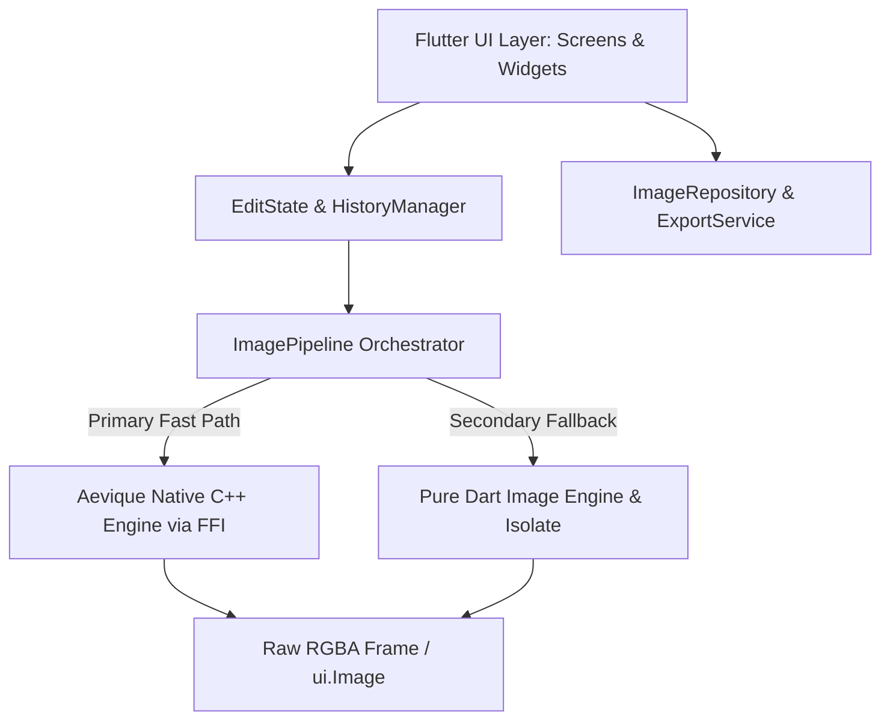

# Architecture

**Analysis Date:** 2026-11-06

## Architectural Pattern

AEVIQUE utilizes a **Layered Hybrid Architecture** combining a high-fidelity reactive Flutter UI layer with an immutable edit state model and a dual-tier image processing pipeline (Native C++ engine via FFI with pure Dart fallback).

## Layers & Components

### 1. Presentation Layer (`lib/screens/`, `lib/widgets/`)
- `SplashScreen`: Staged multi-interval entrance animation (geometry logo -> tracked wordmark -> credit).
- `HomeScreen`: Editorial photo hero, quick camera capture, recent edits carousel, bottom navigation.
- `EditorScreen`: High-performance editing canvas with interactive before/after split viewer, debounced render loop, undo/redo stack, and contextual tool dock.
- `ToolPanels`: Individual modules for Light/Tune, Color, Curves, Details, Effects/Vignette, Crop/Geometry, Portrait Retouching, and Filters.
- `PresetsScreen`: Curated visual preset browser with real-time intensity adjustment and original comparison.
- `ExportScreen`: Full-resolution export controller with format selection, quality slider, gallery persistence, and share sheet.
- `SettingsScreen`: Diagnostic metrics, native engine status, privacy assurance, and developer credits.

### 2. State & History Management (`lib/core/models/`)
- `EditState`: Pure immutable value object representing the complete editing graph (Tune, Curves, Details, Effects, Vignette, Geometry, Portrait, Presets).
- `HistoryManager`: Double-ended undo/redo stack enforcing undo limits and immutability.

### 3. Image Engine & Processing Pipeline (`lib/core/image_engine/`, `lib/core/native_engine/`)
- `ImagePipeline.prepareImageBundle`: Generates constrained preview base (1200px max) and thumbnail base (80px) to decouple UI rendering from multi-megapixel original bytes.
- `ImagePipeline.renderPreviewFrame`: Direct raw RGBA frame rendering with cancellation tokens and stale-frame suppression.
- `AeviqueNativeEngine`: Dynamic library loader with C ABI bindings.

### 4. Native Core (`native/aevique_core/`)
- Pure C++17 library compiled as shared library (`.dylib` / `.so`).
- Low-level vector math for pixel manipulation with zero memory leaks and boundary clamp guarantees.

---
*Codebase analysis: 2026-11-06*
